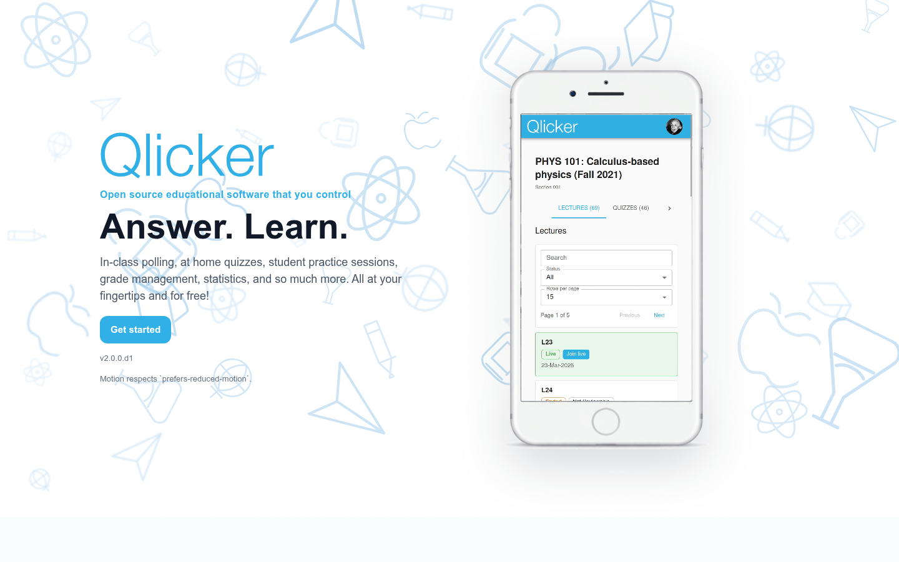

# Qlicker

**Bring everyone into the conversation.**

Qlicker is an open-source classroom response system. Run live questions, quizzes, and anonymous surveys from any browser—no dedicated clicker hardware required. Self-host it with Docker and keep control of your courses and data.



[Get started](#try-it-with-docker) · [User manuals](docs/user-manual/README.md) · [Deploy](production_setup/README.md) · [Contribute](#development)

## Teach, ask, and learn

- **Live teaching:** guide a class through questions and slides, reveal answers, and explore response distributions, word clouds, and histograms in a separate presentation window.
- **Quizzes and practice:** schedule quizzes with autosaved answers, offer practice activities, and review automatic or manual grades with feedback.
- **Surveys and guests:** share an activity with signed-in people outside a course using a short code. Choose anonymous responses for ungraded surveys with linked respondent rows and privacy thresholds.
- **Rich questions:** multiple choice, true/false, multiple select, short answer, numerical answers, images, and LaTeX math. Organize reusable questions with course tags and import/export tools.
- **Discussion and support:** course and session chat, groups, notifications, optional video, and configurable AI assistance for instructors and students.
- **Your institution:** local accounts or SAML SSO, eight interface languages, responsive layouts, and administrator tools for storage, backups, and usage monitoring.


## Try it with Docker

For a local installation, you need **Git, Docker Engine with Compose v2, Bash, and OpenSSL**. Node.js, MongoDB, and Redis run in containers; you do not need to install them separately. These commands target a Linux host; the bundled system monitor uses Linux `/proc` mounts.

```bash
git clone https://github.com/ryanmartinneutrino/qlicker2.git
cd qlicker2
./scripts/setup-docker.sh
docker compose up -d --build
```

The setup wizard chooses ports and generates local secrets. Accept the default ports, then open **http://localhost:3000**. On an empty database, the first account you register becomes the administrator. Configure email delivery to use email verification and password reset.

```bash
# Check startup or follow application logs
docker compose ps
docker compose logs -f server client

# Stop; named volumes retain your database and uploads
docker compose down
```

This root Compose stack is for local use and exposes database/service ports. For a public installation with TLS, authenticated databases, backups, and multiple API replicas, use [production_setup](production_setup/README.md#quick-start).

### Deploy on your server

Build your own images from this checkout, then configure the production stack:

```bash
./scripts/build-images.sh --tag local
cd production_setup
./setup.sh
docker compose up -d
```

Choose the `local` image tags in setup, configure your domain and certificates, and follow the [production guide](production_setup/README.md) for first-run settings, backups, updates, and reverse proxies. Images can also be pushed to your own registry with `build-images.sh --registry … --push`. The source-build path does not depend on a public Qlicker image registry.

**Coming from Meteor?** Start with the [migration guide](meteorjs_migration/MIGRATION.md). Restore and validate a copy of your database before cutting over an existing installation.

## Documentation

| I want to… | Guide |
| --- | --- |
| Join activities and review my work | [Student manual](docs/user-manual/student.md) |
| Teach, run surveys, or grade responses | [Professor and TA manual](docs/user-manual/professor.md) |
| Manage accounts, SSO, storage, AI, and backups | [Administrator manual](docs/user-manual/admin.md) |
| Deploy or upgrade a server | [Production operations](production_setup/README.md) |
| Check classroom-scale performance | [Load testing](load-testing/README.md) |
| Understand or extend the code | [Developer guide](docs/developer/README.md) |

See the [full documentation index](docs/README.md). Signed-in users also have a localized manual in their account menu.

## Development

The application uses React, Vite, Material UI, Fastify, MongoDB, and Redis for optional multi-instance WebSocket delivery. Native development requires **Node.js 22.13 or newer**, npm, MongoDB, and optionally Redis:

```bash
./scripts/setup-native.sh
./scripts/qlicker.sh start
./scripts/qlicker.sh status
```

Each JavaScript workspace has its own lockfile. Read [CODING_STANDARDS.md](CODING_STANDARDS.md) and [AGENTS.md](AGENTS.md) before contributing. Open a focused pull request with tests and documentation for the behavior you change.

```bash
npm test --prefix server
npm test --prefix client
npm run build --prefix client
./scripts/qlicker.sh e2e --install-browser
node scripts/check-doc-links.mjs
```

The [development guide](docs/developer/development-guide.md) covers fixtures, local API addresses, targeted tests, and screenshot capture. The canonical release label lives in [VERSION](VERSION).

### Repository map

| Directory | Contents |
| --- | --- |
| `client/` | React client, component tests, and Playwright workflows |
| `server/` | Fastify API, models, services, and integration tests |
| `scripts/` | Local setup, service control, and image builds |
| `production_setup/` | Production Compose stack, TLS, backup, restore, and upgrades |
| `load-testing/` | k6 classroom, quiz, guest, and anonymous scenarios |
| `docs/` | User and developer documentation |
| `meteorjs_migration/` | Migration instructions and legacy database compatibility reference |
| `ssoserver/` | Local SAML identity-provider test environment |

## License

Qlicker is licensed under the [GNU Affero General Public License v3.0](LICENSE).
