# Professor and TA User Manual

Use this manual to build courses, manage people and reusable content, teach live, run quizzes, review responses, and publish grades. A TA assigned as a course instructor uses the same course workspace; some account-wide actions depend on the person's global role.

If this is your first visit, read [Getting started](getting-started.md) first.

## Contents

1. [Understand the professor dashboard](#1-understand-the-professor-dashboard)
2. [Create and configure a course](#2-create-and-configure-a-course)
3. [Manage students, instructors, and notices](#3-manage-students-instructors-and-notices)
4. [Create and manage groups](#4-create-and-manage-groups)
5. [Build a reusable question library](#5-build-a-reusable-question-library)
6. [Create an interactive session](#6-create-an-interactive-session)
   - [Anonymous surveys](#run-an-anonymous-survey)
7. [Configure and deliver a quiz](#7-configure-and-deliver-a-quiz)
8. [Run an interactive class](#8-run-an-interactive-class)
   - [Join codes and attendance](#use-a-join-code-to-control-attendance)
   - [Manual admission and late arrivals](#manually-admit-a-student-or-handle-a-late-arrival)
   - [Leaving and rejoining](#leaving-and-rejoining-does-not-require-another-code)
9. [Use course chat and session chat](#9-use-course-chat-and-session-chat)
10. [Use AI for teaching and course management](#10-use-ai-for-teaching-and-course-management)
11. [Use course video](#11-use-course-video)
12. [Review a session and grade students](#12-review-a-session-and-grade-students)
13. [Copy, import, export, and prepare the next term](#13-copy-import-export-and-prepare-the-next-term)
14. [Common teaching scenarios](#14-common-teaching-scenarios)
15. [Troubleshooting](#15-troubleshooting)

## Quick start for a live class

1. Create the course and share its enrollment code.
2. Add course topics and confirm the course is active.
3. Create a session, add questions/slides, and check point values and visibility.
4. Launch the session, optionally open the join period/passcode, and make the first question visible.
5. Open/close responses, show statistics or the answer when useful, and move through the pages.
6. End the session, review results, finish manual grading, and make it reviewable when students should see it.

## 1. Understand the professor dashboard

After sign-in, the professor dashboard shows courses you own or teach and highlights currently live activities. Use a course card to open its workspace. Use **Create Course** for a new course shell.

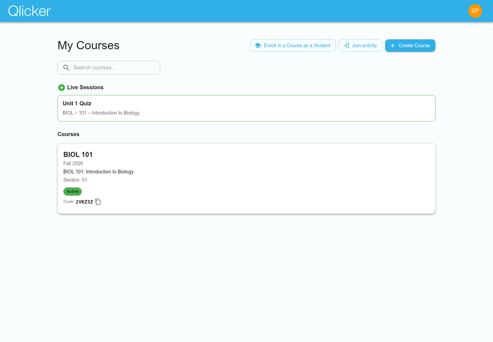

The dashboard is intentionally a launch point, not the place where most configuration happens. Open a course to reach sessions, quizzes, grades, rosters, groups, chat, course settings, and the question library.

### Course naming convention

Choose a convention that stays meaningful after content is copied. A useful pattern is:

- department and number: `BIOL 101`
- descriptive name: `Introduction to Biology`
- section: `01`
- semester: `Fall 2026`

Consistent semester labels make old courses and copied content easier to identify.

## 2. Create and configure a course

### Create the course

1. Select **Create Course** from the dashboard.
2. Enter the course name, department code, number, section, semester season, and year.
3. Select **Create**.
4. Open the new course card.

The course workspace places the major tools in tabs. Live activities also appear above the tabs for faster access.

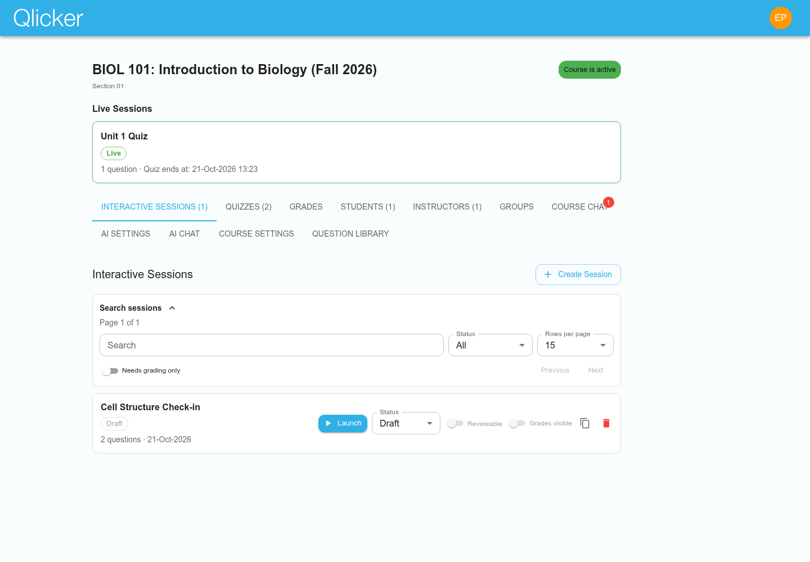

### Configure course settings

Open **Course Settings** and review every item before enrollment:

1. Copy the enrollment code and store it where students can find it.
2. Keep the course active while students need to enroll or work in it.
3. Add course topics. Topics are used for organization and chat/question-library filtering.
4. Decide whether verified email is required for enrollment (when local authentication is enabled).
5. Enable student access to practice questions only when they should see the practice and question-library tabs.
6. Choose whether quiz times inherit the site default or use a course-specific 12/24-hour display.
7. Enable course chat and select its retention period if discussion will be used.
8. Review the editable course name, code, section, and semester.

Settings autosave after changes. Wait for the saved state before navigating away.

Enabling or disabling chat or AI keeps you on **Course Settings**. Course tab links retain their identity even when optional tabs appear; **Back to course** from a session returns to the originating activity or grades tab. **Search sessions** starts expanded on the interactive-session and quiz lists and can be collapsed by selecting its heading.

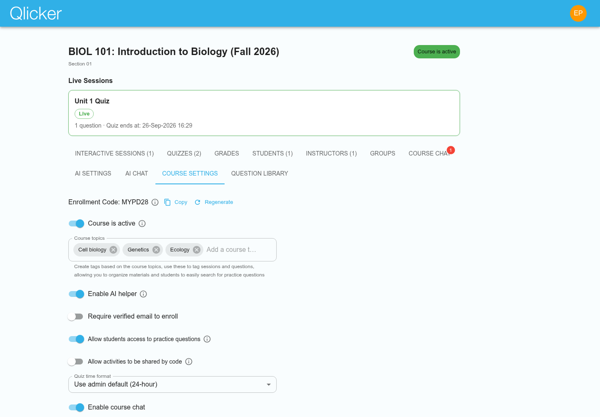

### Rotate an enrollment code

Use **Regenerate** beside the code when an old code should no longer admit new students. Already enrolled students remain enrolled. Share the new code only with the intended class.

### Archive or delete

Make a course inactive when it should no longer accept enrollment or appear as current work. Deleting a course is much more consequential; prefer inactivation for completed terms unless the records truly should be removed.

## 3. Manage students, instructors, and notices

### Students

Open **Students** to inspect the roster. Depending on your permissions, you can add or remove a student and open notification management for the course.

Before removing someone, confirm that the email/user ID is correct and consider the effect on access to past work. Their underlying responses and grades may still be retained for academic records.

### Instructors and TAs

Open **Instructors** to add another instructor by user ID or email and remove instructors who no longer teach the course. A student-role account assigned as an instructor is displayed as a TA in relevant interfaces; this label does not create a separate stored global role.

Never remove the last person responsible for the course without arranging ownership/support access.

### Course notices

1. Open your course, select **Students** or **Instructors**, then select **Manage notifications**. Both buttons open the same course composer.
2. At the top of the dialog, enter a short **Title** and write the notice in **Message**.
3. Leave **Send to** set to **everyone in this course** to include both students and instructors. Alternatively, choose only the course's students or only its instructors (including TAs assigned as instructors).
4. Set the start and end date/time. The default window starts now and lasts 12 hours. Select **Persist until dismissed** if recipients should keep seeing the notice after its end time until they dismiss it.
5. Select **Post notification**, check the audience, and select **Confirm**.

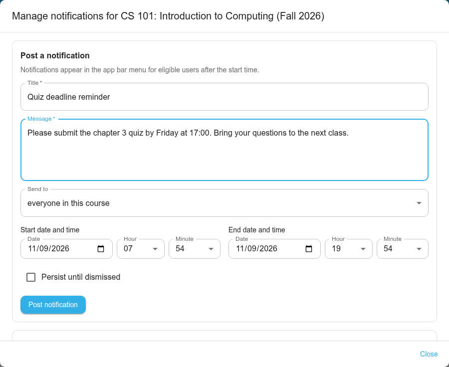

Use notices for a changed quiz window, a reminder, or a class announcement. Recipients open **Notifications** from their avatar menu to read or dismiss them; notices do not send email or open automatically. The avatar-menu dialog is a read-only inbox and has no message-entry fields.

To revise or remove a notice, scroll down to **Existing notifications** in **Manage notifications**. The Title and Message fields are above that list; scroll to the top of the dialog if they are out of view.

When creating a notice:

- make the title actionable
- state the affected course/activity
- include the relevant date/time and time zone
- set an expiry so old alerts do not remain indefinitely

## 4. Create and manage groups

Groups are organized into categories. A student can belong to one group within a category, while the course can have several categories (for example, **Lab Teams** and **Project Teams**).

### Create a category manually

1. Open **Groups**.
2. Select **Create Category**.
3. Enter a category name and number of groups.
4. Select **Create**.
5. Rename groups when descriptive names are more useful than Group 1, Group 2, and so on.
6. Select students to assign them, then verify that nobody is unintentionally unassigned.

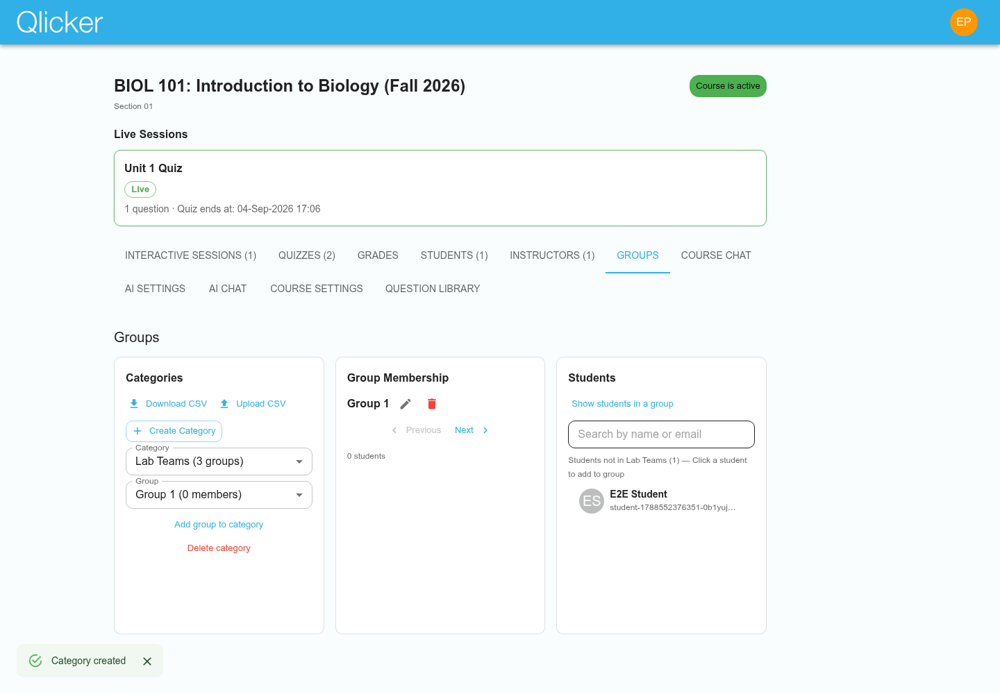

### Import or export groups

- Select **Download CSV** to save the current structure as a roster reference or editing template.
- Select **Upload CSV**, name the destination category, paste/upload the required CSV content, and review the import summary.
- Fix unknown/duplicate email addresses before using the groups for class activities.

Export again after a large change so you have a human-readable record of the final assignments.

## 5. Build a reusable question library

The **Question Library** contains questions you can search, tag, export, copy, and add to sessions.

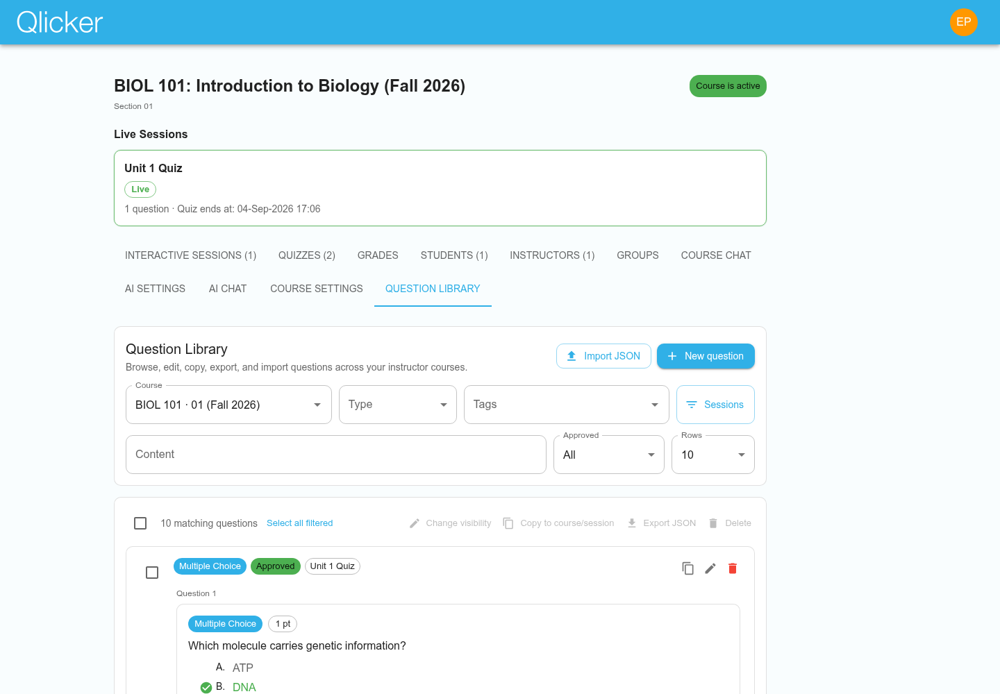

### Question types

| Type | Use it for | Grading behavior |
| --- | --- | --- |
| Multiple Choice | One correct option | Automatically graded |
| True/False | A binary claim | Automatically graded |
| Multi-Select | One or more correct options | Automatically graded using the session's selected scoring method |
| Numerical | A number with optional tolerance | Automatically graded |
| Short Answer | Written reasoning or explanation | Usually requires manual grading |
| Slide | Instructions, worked examples, images, or transitions | Not answerable or graded |

### Author a good question

1. Choose the type before building the response options.
2. Write a prompt that is understandable without spoken context.
3. Mark correct choices or enter the correct numerical value/tolerance.
4. Add a solution/explanation; students see it only when the workflow releases it.
5. Add course topics/tags.
6. Set visibility deliberately.

Use the rich-text editor for equations, images, lists, links, color, and code only when they improve comprehension. Preview mathematical notation and verify image alternative/context in the surrounding prompt.

### Visibility levels

Keep assessment content private unless it is intended for reuse or student practice. Course-visible and Qlicker-wide visibility can expose a question outside the session where it was first authored. Student library access also depends on the course's **Allow students access to practice questions** setting.

Copying a library question into a session creates an independent question with a new ID, even if that question is already in the session. Editing or answering one copy does not change another. Copying a session also creates fresh copies of its questions.

### Library bulk actions

Use filters and **Select all filtered** carefully: bulk export/copy acts on the matching selection, not necessarily only the items currently visible on one page. After copying to another course or session, inspect the copied version's tags, point value, and solution.

## 6. Create an interactive session

### Create the shell

1. Open **Interactive Sessions**.
2. Select **Create Session**.
3. Give it a specific name and description.
4. Open the session card to enter the editor.

### Build the ordered flow

In the session editor you can create a new question, add from the library, insert a slide, import JSON, and move pages up/down. Questions copied into a session become session-specific copies, so later session settings do not change the original library item.

Use **Expand all previews** above the question list to open every preview, then **Collapse all previews** to close them. You can still expand or collapse individual previews. If only some are open, the bulk button expands them all.

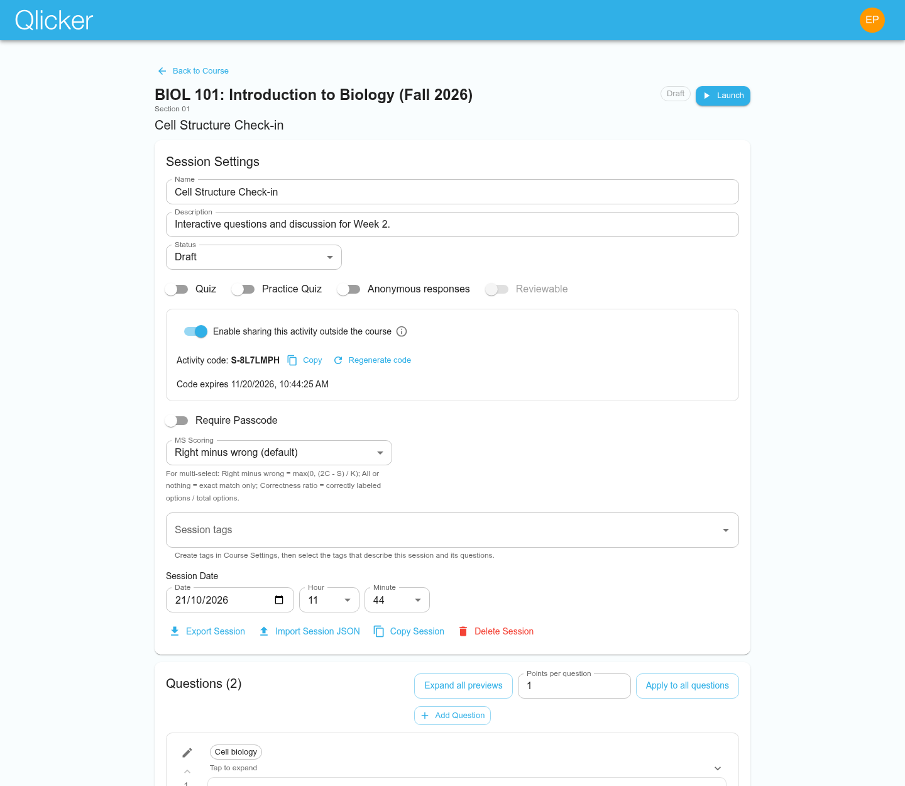

For each question, review:

- point value (short answer defaults may differ from objective questions)
- maximum attempts and attempt weights
- correct answer/solution
- tags and visibility
- whether response data already exists, which can restrict editing to protect historical results

Use **Set all question points** only after considering ungraded slides and deliberately zero-point participation questions.

### Session-level controls

- **Status** controls whether the activity is hidden/draft, visible, running, or ended. When an interactive session becomes Live, Qlicker selects the first question or slide if none is active. An existing active item is preserved. A newly selected first item starts hidden until you reveal it, just as with Launch.
- **Reviewable** releases session review and grades. **Grades visible** can release only summary grades after the session ends.
- **Join code/passcode** and refresh interval provide controlled entry for live activities.
- **Multi-select scoring** applies to multi-select questions in the session.
- **Anonymous responses** hides who gave each answer. See [Run an anonymous survey](#run-an-anonymous-survey).
- Create tags in **Course Settings**, then select them in the session editor to organize the session and apply tags to questions.

For an **Upcoming** interactive session, enrolled students can select **Open waiting page**; guests can enter its **S- activity code** through **Join activity**. Waiting does not record attendance. The instructor can still edit the session and require a live join code. When the session goes **Live**, participants wait for a question or enter the join code once the instructor opens the join period. Redeeming an activity code still locks the anonymity setting.

Do a student-view rehearsal before a high-stakes activity. Confirm the session appears on the intended tab and that solutions are not exposed early.

### Run an anonymous survey

Use **Anonymous responses** for course feedback, sensitive check-ins, or any interactive session or quiz where students should answer candidly.

1. Create the session. If it is a quiz, configure the quiz window.
2. In the session editor, turn on **Anonymous responses**. The session card then shows **Anonymous**.
3. Add questions and run or publish the session as usual.

What changes:

- Students still sign in and can answer each question (or each attempt) only once. A quiz can still be submitted only once. Students see a notice that the session is anonymous and can review their own answers later.
- Changing a live interactive session to **Upcoming** replaces participants’ questions with a waiting screen; returning to **Live** restores the session and their saved answers. **Draft** returns enrolled students to the course page and guests to their dashboard.
- During an anonymous live activity, response counts update immediately. Statistics and unlinked answer lists update after at least four new people respond to that question and attempt. Show Stats controls what participants and the presentation window see; the instructor sees released statistics even while Show Stats is off. Word clouds and histograms use those same released answers. The last one to three answers wait for the next batch. After the activity ends, review releases answers separately for each question and attempt with at least four respondents. Smaller groups show their actual response count and an “answers hidden” notice; they do not hide eligible answers elsewhere. Overall percentages stay hidden while any answers are withheld. The Response Data table and CSV have separate columns for anonymous attempts; Responses by question lets you choose the attempt. AI analysis, word clouds, and histograms retain their whole-activity minimum until every answered question/attempt has four respondents. The joined-student list, manual admission, and individual quiz extensions are unavailable. Share the live join code if one is required.
- After the session ends, review shows respondents as **Respondent 1**, **Respondent 2**, and so on, with one row per respondent across questions but without join times or grades. The CSV export uses the same labels. The **Responses by question** tab uses the grading interface’s question navigator and full preview, including options, correct answers, and the optional solution. Below it, a read-only table shows each respondent’s answer and whether it was correct; grading controls remain unavailable.
- The session is never graded and does not appear in the course gradebook. AI grading is unavailable, and session chat does not show authors' names.
- The setting locks once anyone joins, saves an answer, or submits. Anonymous quiz/interactive mode also locks after participation. Remove any individual quiz extensions before enabling anonymity.

The instructor’s live Controls show an information banner explaining that statistics are hidden until four different participants answer the current question and attempt. After the first release, the banner shows the released response count and explains batching.

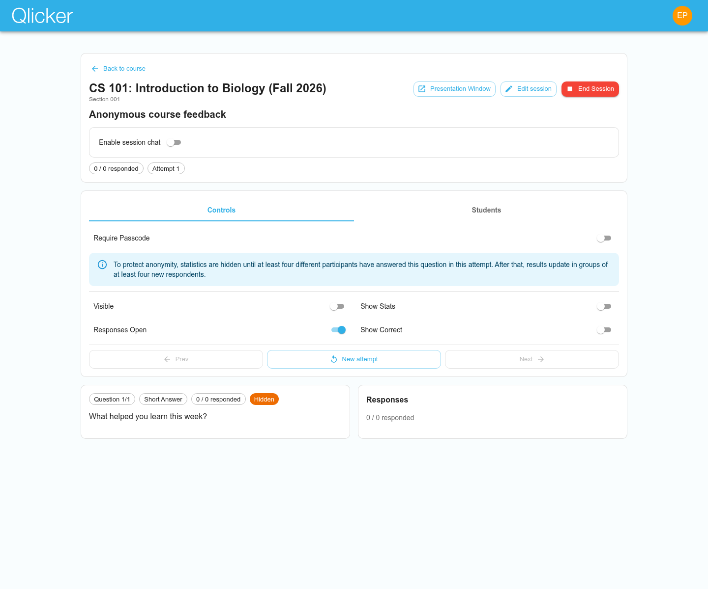

Linked rows are needed to correlate survey answers, but a unique or self-identifying answer can expose the rest of that respondent's row. The four-person minimum reduces direct identification by elimination, but does not prevent inference from unique answers or knowledge of who participated. Label numbers do not follow answer order or names.

### Share a quiz or live activity outside the course

The session editor shows sharing controls only when the course allows activity sharing.

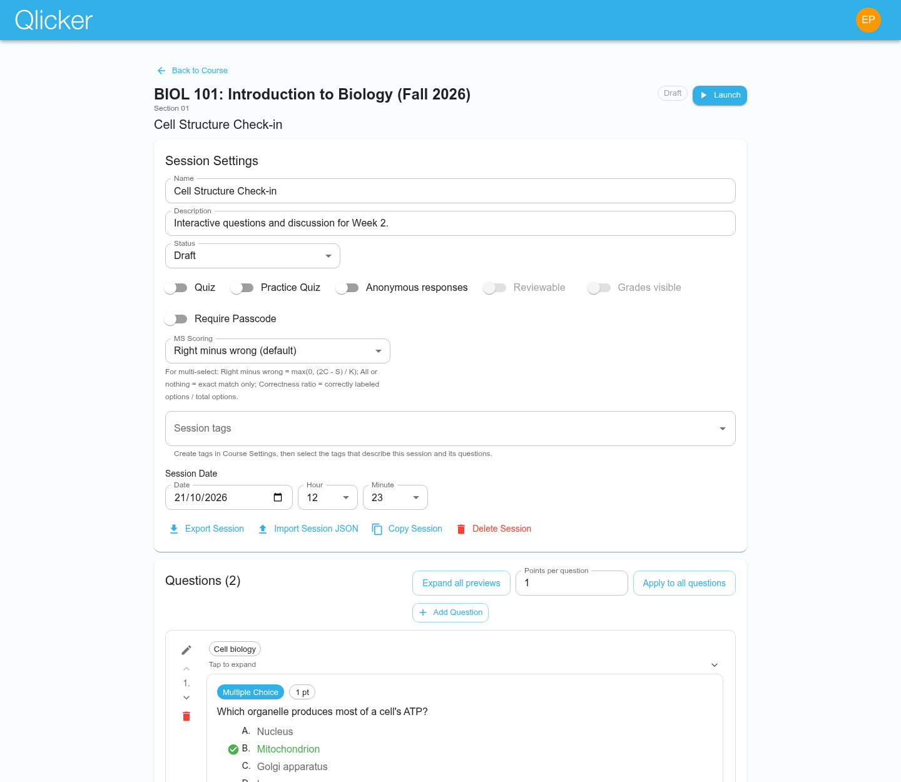

In **Course settings**, turn on **Allow activities to be shared by code**; it is off by default. Turning it off later revokes all codes and outside access for that course. Create the activity inside the course, add its questions, and set its normal quiz window or live settings. In the session editor, switch on **Enable sharing this activity outside the course** to generate a code beginning with `S-` followed by seven letters or digits. The current code stays visible to course instructors after a refresh and also appears in the live session controls. Switching sharing off makes the stored code unusable and revokes all outside grants. Switching it on again reuses the same code; prior participants must redeem it again. **Regenerate code** replaces the code, invalidates the old one for new redemptions, and retains existing grants. Codes expire for new participants after 30 days by default; a participant who already redeemed a code can still re-enter it until sharing is disabled. The separate rotating six-digit live join code remains in force when **Require Passcode** is on.

For activities with identified responses, participant lists and results label enrolled students and guests. A professor participating from outside the course also has a **Professor** badge and remains a guest for grading. Anonymous results show respondent labels only.

Participants select **Join activity** on their dashboard and enter the code. Instructors can use the same action on their dashboard to participate in another course’s shared activity. The code admits signed-in people to this activity only. It does not enroll them in your course or give them course roster, gradebook, chat, or question-library access. Joined guests can use enabled session chat during a live activity. You can choose named or anonymous responses before anyone redeems the code or participates. Once someone redeems it, the anonymity choice is locked. Anonymous responses retain one respondent row across eligible questions. After the activity ends, each question and attempt is released independently when at least four people have answered it. Unique answers can still identify a respondent.

Activity codes do not work while the activity is in Draft, even for previous participants. The same code becomes usable when the instructor publishes the activity.

**In a named shared activity, enrolled students can receive grades; guests have tracked responses but no grade items.** The instructor review shows both groups and marks guests as ungraded. Only enrolled students appear in the grading controls and course gradebook. If a guest later enrolls as a student (including someone with a professor account), Qlicker creates missing grades from their saved responses in finished activities. Missed activities receive zeros without a needs-grading flag; written answers may need grading. Existing marks and feedback are preserved. Anonymous activities remain ungraded. For someone already enrolled before this update, **Create grade items** fills missing rows. Turning on anonymity makes the activity a survey: no one receives grades, but respondents retain one linked row across questions after the privacy threshold is met. Existing enrolled-student grades do not prevent a named activity from being shared; existing grades for people outside the course or any grades on an anonymous activity do. Remove individual quiz extensions before sharing. Extensions stay unavailable after a code is issued, even if sharing is later disabled. Practice quizzes and student-created sessions cannot be shared by activity code.

## 7. Configure and deliver a quiz

Create a session, enable quiz mode, and configure its window. A normal quiz is student-paced during the availability period; a practice quiz is intended for lower-stakes rehearsal.

### Before publishing

1. Set the start and end time and confirm the course's 12/24-hour preference.
2. Add all questions and check the order, points, solutions, and multi-select method.
3. Add per-student extensions/accommodations where needed.
4. Make the quiz visible only when the listing should appear.
5. Preview with a non-instructor test account if the assessment is high stakes.

### During the window

The status dropdowns in the course page and session editor control the same setting. **Switch to Live/Ended based on dates** follows the quiz schedule and extensions. **Live** opens the quiz immediately, even outside the scheduled dates, and keeps it open until you change its status. **Ended** closes general access while preserving individual extensions. Setting a quiz to **Live** keeps you in the editor; choose **Review Live Session Results** to monitor responses.

Students' answers save while they move through the quiz. The course/dashboard cards show the relevant start/end time. Submitted normal quizzes cannot be edited again. Avoid editing question meaning or scoring while students are actively answering.

### After the window

End the quiz/session, recalculate grades, complete manual grading, and enable **Reviewable** only when answers and feedback should be released. A submitted quiz is excluded from the student's live quick-access area even if the overall window remains open.

### Extensions after ending a quiz

Open the quiz editor and use **Manage extensions** to assign enrolled students their own start/end times. You can add an extension after setting the quiz to **Ended**; do not reopen the whole quiz. The professor's quiz card stays **Ended** and shows **Extensions Active** during an individual window. Assigned students can open, save, and submit during that window; other students cannot. An extension does not unlock an already-submitted normal quiz.

Active and upcoming extensions block **Reviewable**. Granting a remaining extension switches off existing student review and grade visibility; it cannot undo answers students have already seen. After the last extension expires or is removed, recalculate grades to include late responses, complete manual marking, and explicitly enable **Reviewable**. Review never becomes available automatically.

## 8. Run an interactive class

For an open quiz, results show only students and guests who have clicked **Submit**, using their final saved answers. The page updates when quizzes are submitted. Once the quiz is **Ended**, saved answers from participants who did not submit are also included and can be graded normally. This applies to result tables, exports, and response analysis. Anonymous quizzes still wait until the activity ends and the privacy threshold is met. Practice quizzes continue to submit per question.

Select **Launch** on an interactive session. The professor control view is separate from the student and presentation views.

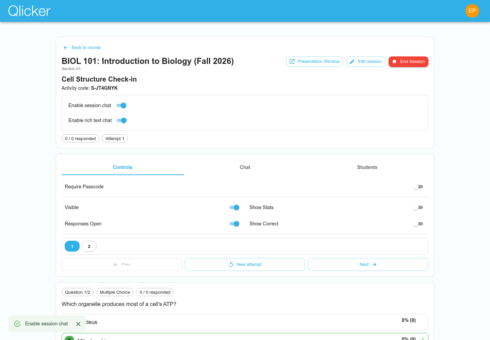

### Recommended sequence

1. Open the optional presentation window on the classroom display.
2. For attendance-controlled entry, enable **Require Passcode**, then **Join Period**, and display the current code in the classroom.
3. Admit waiting students manually when appropriate.
4. Close **Join Period** after check-in; keep **Require Passcode** enabled to prevent new students from entering without your approval.
5. Select the intended page and turn on **Visible**.
6. Open the response attempt; watch joined/responded counts.
7. Close responses before discussing results.
8. Show statistics and/or the correct answer when pedagogically useful.
9. Start another attempt or move to the next page.
10. Select **End Session** and confirm when class is finished.

### Use a join code to control attendance

The course **enrollment code** enrolls a student in your course. The interactive session's six-digit **join code** admits an already-enrolled student to that particular live session. These are different codes with different purposes.

1. Enable **Require Passcode** before students start joining. Without it, enrolled students can enter a running session without a code; closing a join period alone does not restrict entry.
2. **Launch** the session. Launching does not automatically open admission. In the live **Controls**, turn on **Join Period** when you are ready for students to check in.
3. Use **Open presentation window** to display the current code in the room. Students open the live session from their course and enter that six-digit code.
4. Set **Refresh (sec)** to a value from 5 to 120 seconds. Keep the professor's live controls open for automatic rotation. **Refresh join code** replaces the code immediately; students who have not yet joined must use the currently displayed code.
5. After your attendance check-in window, turn off **Join Period**, leaving **Require Passcode** on. New students can no longer enter by code, but you can still admit an individual student manually.

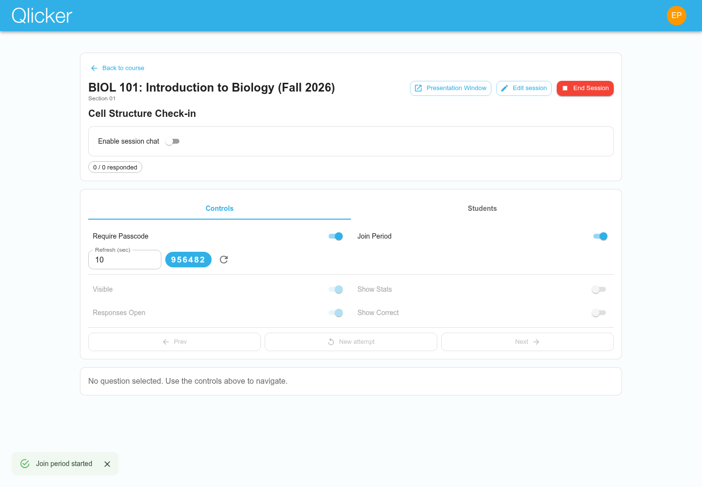

Use this workflow for attendance-controlled interactive sessions: show the code in class, allow a short check-in window, and handle exceptions individually. A code can be shared, so admission is not proof of physical presence or continued attendance. Check response participation and follow your institution's attendance policy when recording attendance marks.

### Manually admit a student or handle a late arrival

1. While the session is running with **Require Passcode** enabled, open **Students** in the professor's live view.
2. Expand **Waiting to join** and filter by first name, last name, or email.
3. Verify the student's identity and select **Admit** next to that student. They must already be enrolled in the course.
4. The student is added to the session without entering a code. Manual admission works even when **Join Period** is closed, so you need not reopen admission for the whole class.

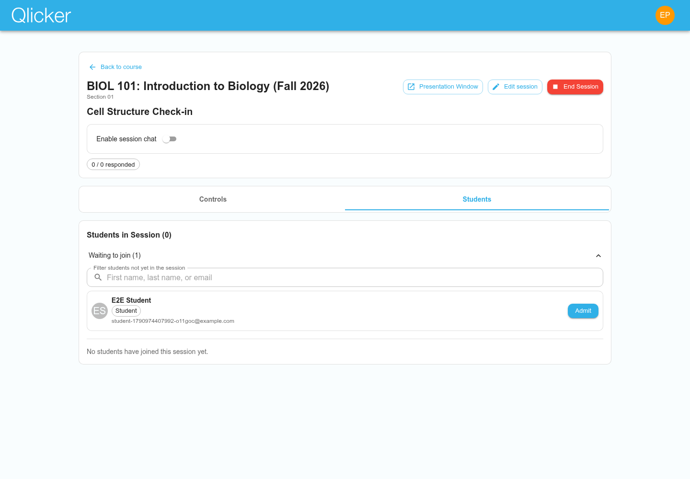

**Waiting to join** lists enrolled students who have not joined; it is not evidence that they are currently online or actively requesting admission. If a student is missing, check their course enrollment and your filter.

Anonymous sessions have no **Waiting to join** list or manual admission, because admitting someone would show whether they had already joined. Give late students the current code instead.

### Leaving and rejoining does not require another code

Once a student has joined by code or been manually admitted, their admission is retained for that session. Leaving the page, refreshing, or losing a connection does not remove it: they can reopen the running session using the same account without another code, even after you rotate the code or close **Join Period**. Enabling a passcode later also does not remove students who already joined.

For example, admit a verified late arrival individually after closing check-in. If that student's Wi-Fi drops later, they can reconnect without asking you to admit them again. A separate session has its own admission; admission to today's session does not admit them to the next class.

### What each audience sees

- The professor always sees control information and, for short answer, the response list needed to moderate the class.
- Students see only pages, statistics, correct answers, and shared short-answer lists that you have revealed.
- The presentation window follows the same question, visibility, statistics, correct-answer reveal, and attempt as the student view. Both numbered question buttons and Previous/Next update it automatically. Student names remain anonymous in presentation responses and chat, and reconnecting restores the current classroom state.

Statistics include option distributions, word clouds for suitable short answers, and histograms for numerical responses. The shared short-answer response list can be hidden separately from its word cloud.

### Multiple attempts

Open a new attempt when students should answer again after discussion. Attempt weights/max attempts affect grading, so set them before class and explain the policy. Live response totals should be interpreted per current attempt.

Each new attempt resets the displayed counts. **Show Stats** works in the professor, student, and presentation windows for that attempt without reloading; option statistics start at zero before responses arrive.

## 9. Use course chat and session chat

Course chat and session chat solve different communication problems. Explain that distinction to students before using both:

| Tool | Best for | Lifetime |
| --- | --- | --- |
| **Course Chat** | Questions, resources, and discussions that should remain useful across classes | Continues across the course and follows the configured retention period |
| **Session Chat** | Immediate confusion and question-specific discussion during one live activity | Attached to one session and retained for instructor review |

### Course chat

1. Open **Course Settings**.
2. Enable **Course Chat** and choose a retention period.
3. Open the new **Course Chat** tab.
4. Select **New post**, enter a required topic, add relevant course-topic tags, write the post, and publish.

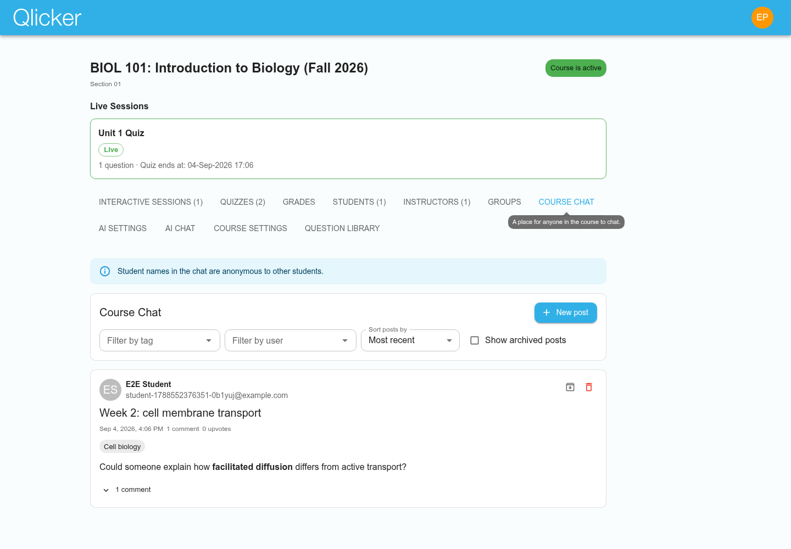

Posts and comments support rich text, images, equations, links, and embedded video. Students can upvote helpful topics and comments. Instructors can:

- see student identities for moderation while students see anonymous role labels
- filter by course topic or author and sort by time or upvotes
- reply to a topic without starting a duplicate thread
- archive and restore discussions; archived material is hidden from the active list but not deleted
- delete inappropriate posts or comments when removal is required

The retention setting automatically archives older topics. Choose a period long enough for the discussion to remain useful, but do not treat chat as a permanent records system.

### Session chat during a live activity

1. Launch the interactive session.
2. Turn on **Enable session chat** in the live controls.
3. Decide whether **Enable rich text chat** should also be on.
4. Open the **Chat** panel. Unseen-count badges continue updating when you return to question or student controls.

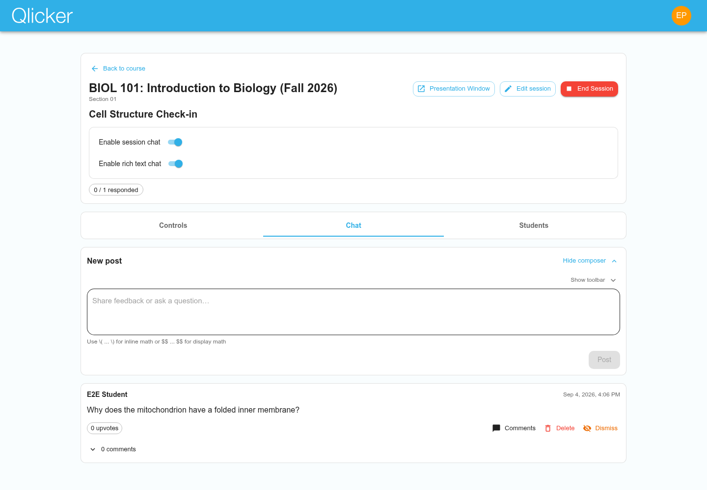

Session chat supports normal posts, comments, and votes when rich text is enabled. Students can also use quick posts associated with the current or an earlier question. Quick posts remain available when rich text is disabled, giving you a lower-distraction clarification channel.

Session chat shows the most recently active discussion first. A new post, comment, or upvote moves the discussion to the top. Unread badges clear when you open Chat. Dismissed discussions remain below active ones for instructors.

Guests who have joined a shared live activity can use its enabled session chat, including quick posts, comments, and votes. This does not grant access to course chat. In anonymous activities, other participants and instructors cannot see guest or student identities in chat. Avoid identifying yourself in message text.

Use **Dismiss** when a question has been resolved but should remain in the record. Delete only when content truly needs removal. The instructor review page retains the conversation, including dismissed items, after the session ends.

### Chat operating practices

- Tell students whether you will monitor chat continuously or only at pauses.
- Ask students to upvote an existing question rather than post duplicates.
- Keep graded responses in the question interface; a chat message never submits an answer.
- Disable rich text, or all session chat, when it distracts from the activity.
- Review unresolved threads after class and move durable answers to course chat or normal course materials.

## 10. Use AI for teaching and course management

Qlicker has several distinct AI workflows. Enabling AI Chat does not automatically run AI grading, and generating a response summary does not change student marks.

### 10.1 Enable AI for a course

AI requires two levels of authorization:

1. A site administrator enables AI and authorizes this course.
2. A course instructor enables **AI Helper** under **Course Settings**.

After both steps, **AI Settings** and **AI Chat** appear. If the switch says administrator authorization is required, ask the administrator to enable the course; do not paste an API key elsewhere as a workaround.

### 10.2 Configure models, access, and reusable instructions

Open **AI Settings** to configure:

- the default model used for instructor AI Chat
- administrator-provided models approved for this course
- optional course-specific OpenAI-compatible backends, when the administrator permits them
- model display names and which individual models students may use
- maximum tool rounds for instructor and student conversations
- whether student AI Chat is enabled, its default model, and course-specific guidance
- reusable instructions for AI grading, student feedback, and response summaries

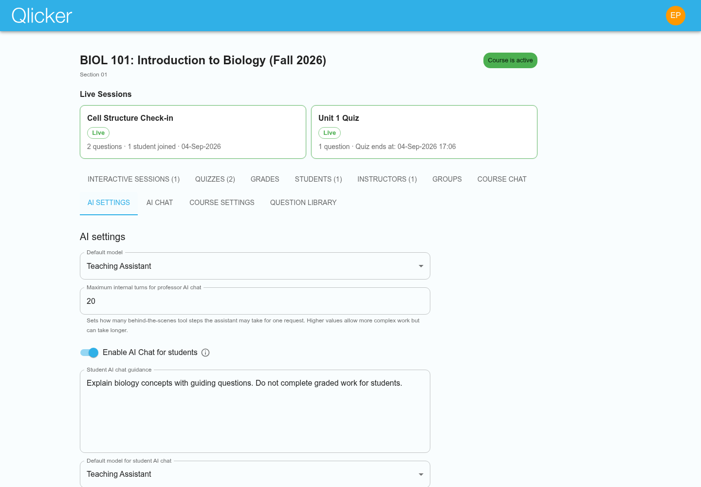

API tokens are write-only after saving. A blank token field does not mean the saved secret was lost. Test model discovery and a low-risk chat before relying on a new backend. Copy reusable rubrics from another course only after checking that their criteria still apply.

### 10.3 Use instructor AI Chat

Start a new conversation in **AI Chat**, choose a model, and state the task with the relevant session or topic name. Keep separate conversations for unrelated jobs.

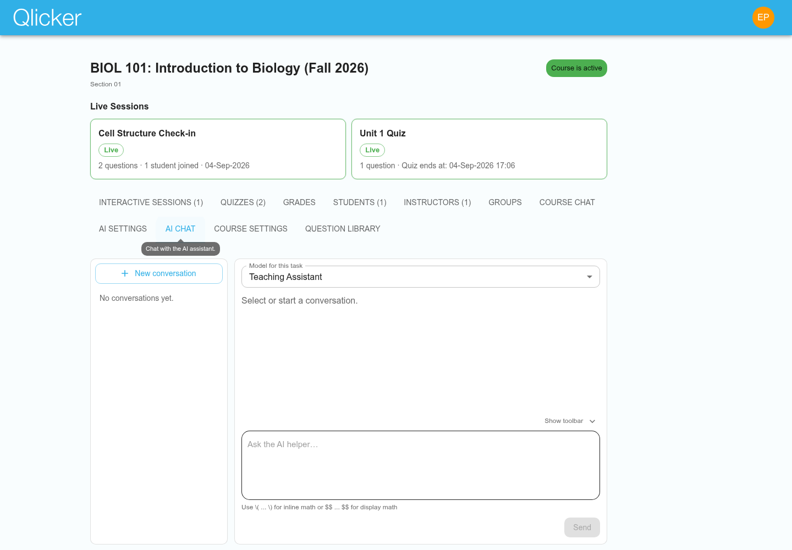

The instructor assistant can use course-scoped tools to:

- inspect the roster and course/session schedule
- inspect session settings, questions, final-attempt responses, aggregate performance, and grade tables
- read course-chat topics and comments
- create new interactive sessions, quizzes, and questions
- prepare edits to existing sessions/questions or draft a course-chat topic/response

Creating a session or question happens immediately and generated questions receive a **Generated by AI** tag. Inspect the new content, correct its topic/visibility/points, and verify quiz dates before using it.

Edits to existing sessions/questions and course-chat posts use a safer two-turn workflow. The assistant shows an exact draft and a draft-specific approval phrase. Nothing is applied until you review it and send that exact phrase in a later message. The assistant cannot delete course data.

Large rosters, response sets, chats, and grade tables are paginated. If the assistant says it inspected only part of the data, narrow the question or ask it to continue; do not treat a partial result as a complete class analysis.

### 10.4 Summarize written responses

From **Session Review**, locate an individual question and select **Generate AI Response summary**:

1. Choose an approved model.
2. Select or create a reusable summary instruction. Save edits before generating; generation is disabled while instructions are being edited. The saved selection stays selected when you reopen the dialog, and its language, focus, and output-format guidance is sent at every summarization stage.
3. Start the job and monitor its progress.
4. View the finished summary, or halt and regenerate it if needed.

Response summaries help identify themes in free-text work. They do not award points or replace reading representative responses, especially when nuance or sensitive language matters.

### 10.5 Use the AI Grading Assistant

AI grading is available from the session **Grading** tab after the session has ended:

1. Open **AI Grading Assistant**.
2. Select eligible questions.
3. For every selected question, choose or create separate **grading instructions** and **feedback-to-student instructions**.
4. Choose an approved model and start grading.
5. Monitor progress; halt if the instructions or results look wrong.
6. Read the report and detailed run log.
7. Inspect individual points and feedback before releasing review/grades.

Halting or a backend failure preserves completed work and a partial report. Treat that as a prompt for review, not evidence that every response was processed.

### 10.6 Configure student AI Chat

Student AI Chat is off until you explicitly enable it in **AI Settings**. Approve only suitable models, set a default and a smaller tool-round limit, and write guidance describing acceptable course use.

The student assistant can see only the student's visible session overview, questions/solutions from ended reviewable sessions, and that student's released grades/feedback. It cannot inspect another student's work, hidden solutions, draft sessions, instructor tools, or instructor conversations.

### AI review and privacy checklist

- Follow institutional rules for sending student/course data to the configured model provider.
- Do not include secrets or unnecessary personal information in prompts.
- Verify generated questions, correct answers, dates, summaries, grades, and feedback.
- Read every proposed write action before using its approval phrase.
- Keep a human path for students to question an AI-assisted grade or explanation.

AI output can be wrong even when it sounds confident.

## 11. Use course video

If an administrator enabled Jitsi and the course is configured for it, the **Video** tab/window provides course or group meeting entry. Test the institution's Jitsi domain, microphone/camera permissions, and group assignments before relying on it in class.

Video access and group destinations depend on the current course and group configuration. Keep an alternative participation route for people who cannot grant microphone/camera access.

## 12. Review a session and grade students

Open **Review** from a completed session/quiz card. A running interactive session may be reviewed for monitoring, but grading remains locked until the activity is ended.

The **Response Data** table displays points only for an actual question mark. Recorded zeros remain visible; anonymous respondents and guests without grade items have no point suffix. CSV points are blank when no mark exists.

Select **Export CSV** in **Response Data** to open the export options. Enable **Include response timestamps** to add **Q1 Time**, **Q2 Time**, and so on beside the response and points columns. Questions with multiple attempts have a time column for each attempt. The option is off by default; exports preserve the table's current search and sort order.

Quiz times represent the last saved modification of each answer; interactive-session times represent when the student submitted that response. Older records fall back to their creation time. Times use ISO 8601 with milliseconds and an explicit UTC offset, such as `2026-03-15T08:00:00.000-04:00`, in the downloading browser's timezone with the offset that applied on the response date (including daylight saving time). This does not recover the student's original timezone or the time of final quiz submission. Missing or invalid timestamps remain blank. Anonymous activities never export response timestamps.

The CSV's **Joined Session** column always uses the same ISO 8601 format, whether or not response timestamps are enabled. Missing join times are blank. The suffix `-04:00` means four hours behind UTC: `2026-10-02T15:59:58.771-04:00` is October 2 at 3:59:58.771 p.m. in Toronto, equivalent to 19:59:58.771 UTC. The offset reflects daylight saving time at that date.

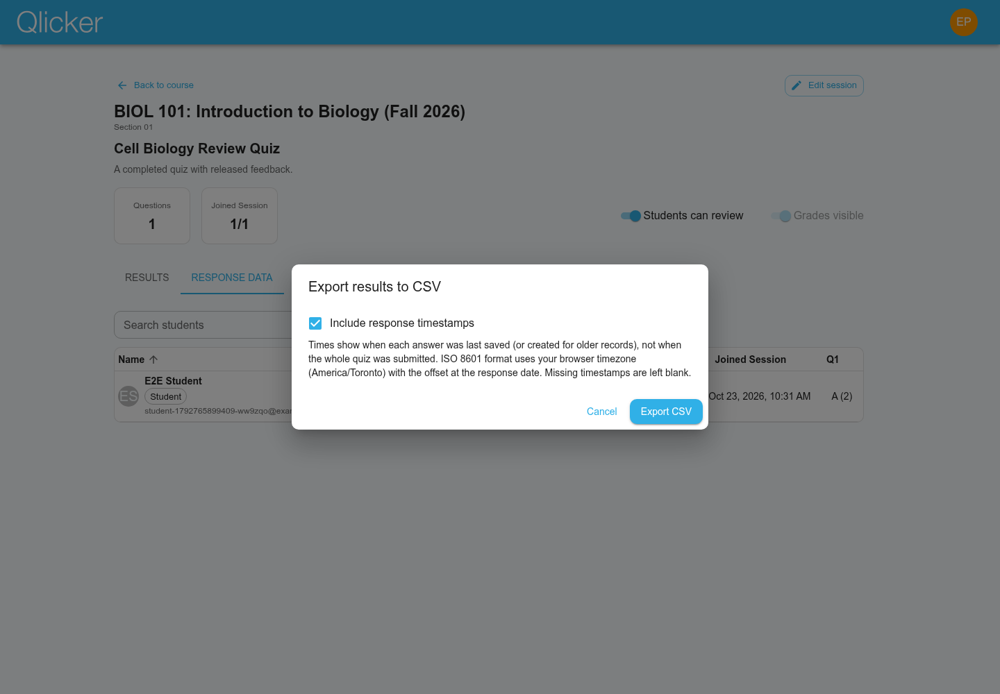

### Response timelines

The **Results** tab starts with a **Session response timeline**, collapsed on page load, combining recorded responses from all questions and attempts. Each question/attempt also has its own expandable **Response timeline**, using only that attempt's response timestamps to set its range. Multiple attempts appear as separate graphs, not combined into one question graph. Bars show response counts per time interval; empty intervals preserve pauses between live periods. **Detail** changes the interval size automatically for a coarse or fine view.

The range is inferred from the earliest and latest available response timestamps, rounded outward to complete intervals. No session start/end times are recorded for this feature. Quiz charts count each answer once at its last saved time, rather than showing every edit or final quiz submission. Interactive-session charts count responses at submission. Missing or invalid timestamps are excluded with a visible count. Anonymous activities do not show timelines.

For quizzes, dotted vertical lines mark scheduled opening and closing dates within the plotted range. The dates are also listed below, including dates outside the response range. They are reference markers only: responses before opening or after closing remain visible, including responses during extensions or manual live mode. Existing review rules still apply: an ongoing quiz exposes submitted participants only; ended quizzes include saved, unsubmitted answers too.

Times use the browser's timezone. Hover or tap a chart to inspect an interval and its count. With keyboard focus on the chart, use Left/Right, Home/End, and Escape. On narrow screens, the chart scrolls horizontally within its card.

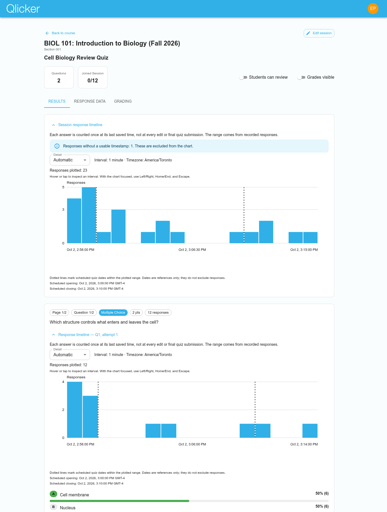

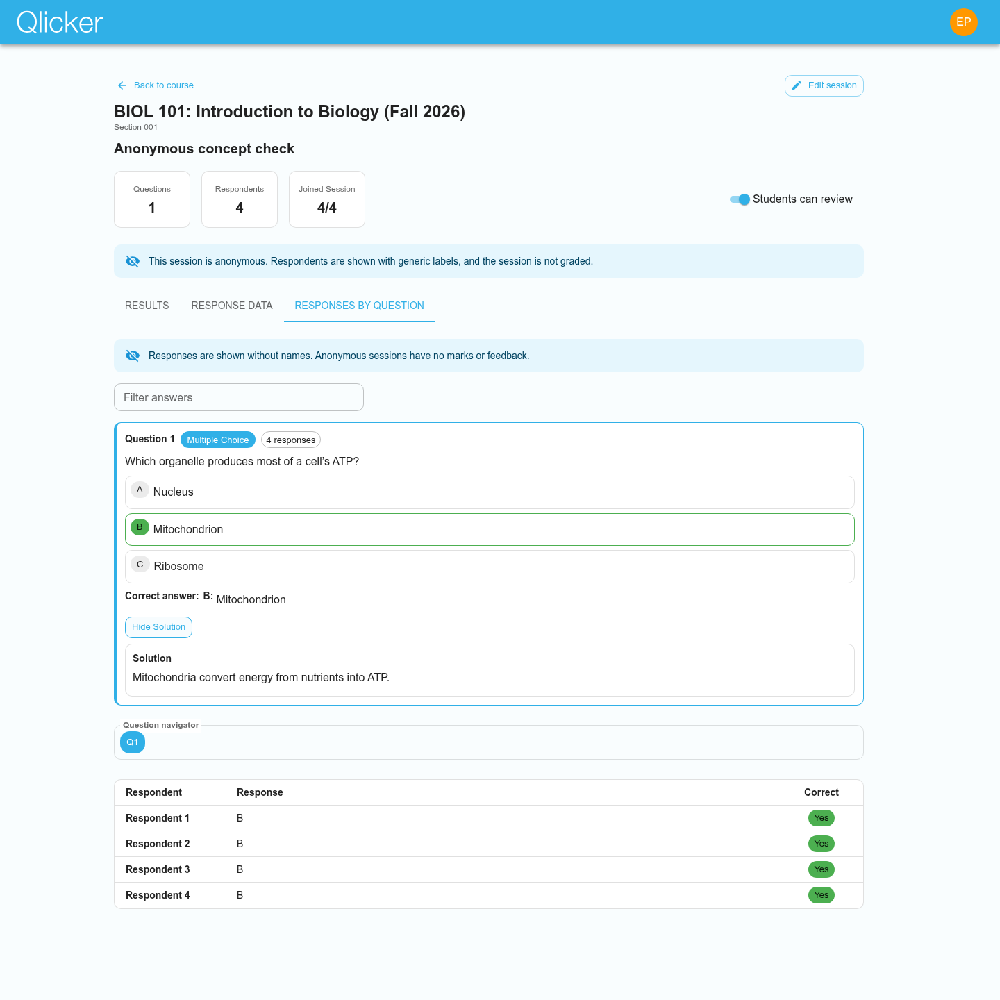

Review tabs can include result summaries, per-question response data, students, grading, and chat history. Use them to answer different questions:

- **Results/response data:** What did the class choose or write?
- **Students:** Who joined, submitted, or needs follow-up?
- **Grading:** What was autograded, what needs manual work, and what conflicts exist?
- **Chat:** What questions/comments occurred during the session?

### Course grade table

Open the course **Grades** tab and choose **Show Grade Table**. Use **Select sessions with grade items** to select the matching sessions that have grades. Sessions labelled **No grade items** remain available for manual selection or **Select All**.

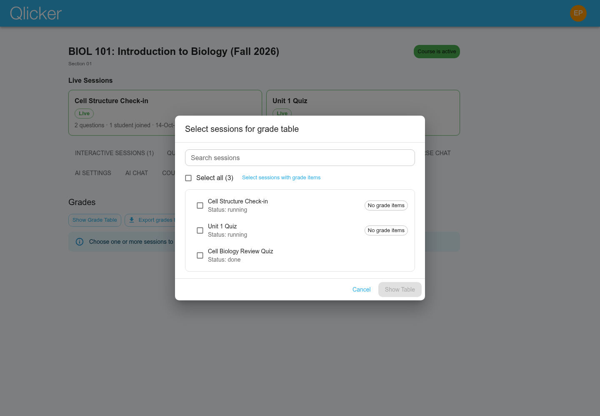

Use **Grades visible** beside **Reviewable** on the session card, session editor, or review page to release summary scores without allowing session review. Turning **Reviewable** on releases grades too; turning it off hides grades, after which you can explicitly release only grades. Grade visibility is locked on while review is enabled. Publication requires an ended session with no remaining extensions. Anonymous sessions have no grades or grade-visibility switch.

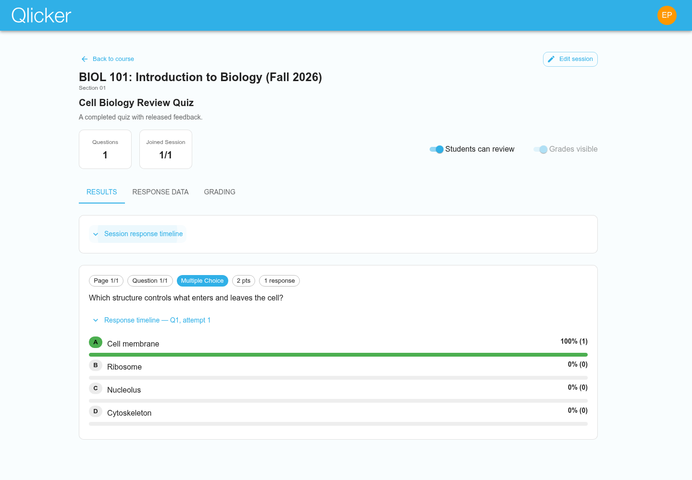

Average grade and participation use only each student's actual, applicable grade items from the displayed sessions. Missing grade items appear as **Not applicable** and do not reduce the average; recorded zeros do count. With no applicable grade items, the average is **Not applicable**. CSV exports use the same averages.

Select a percentage cell to inspect the student's grade; select a question label such as `Q1(SA)` to grade that response.

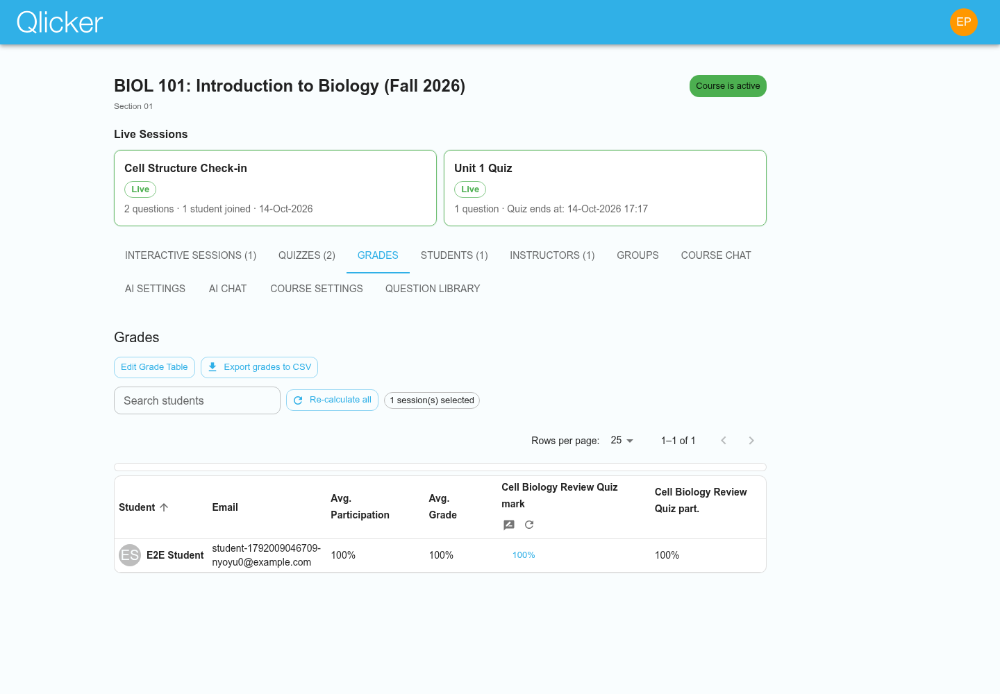

### Safe grading sequence

1. End the session.
2. Recalculate grades if scoring/content changed or results have not been seeded.
3. Manually grade short answers and other flagged work.
4. Add concise, actionable feedback.
5. Resolve automatic-versus-manual conflicts deliberately; recalculation preserves manual overrides.
6. Confirm the overall percentage and point totals.
7. Enable reviewability/grade visibility when release is intended.
8. Export CSV for your external gradebook and inspect the file before importing it elsewhere.

Anonymous sessions have no grades. Their review shows respondent labels and a **Responses by question** tab instead of **Grading**. After the activity ends, each question and attempt releases answers once at least four people have answered it. Smaller groups show their true count and a withholding notice, while other eligible answers remain visible. Anonymous sessions have no gradebook column. See [Run an anonymous survey](#run-an-anonymous-survey).

Changing a question's point value from review triggers a full session recalculation after confirmation. Existing manual marks remain preserved. For the detailed calculation and visibility rules, use the [Grading guide](grading.md).

## 13. Copy, import, export, and prepare the next term

### Sessions

- Copy one session from its card, or use the multi-session copy workflow.
- Choose a destination course and decide whether point values should be preserved.
- Review dates, passcodes, status, reviewability, tags, and visibility in the destination.
- Export JSON for transfer/backup of editable content; use PDF/print output when a human-readable version is needed.

### Questions

- Export selected library questions to JSON.
- Copy selected questions to another course or session.
- Import JSON, review the item count, then inspect every imported question.

Content exports are not a substitute for database backups: they do not contain all enrollment, response, grade, settings, and account data.

### End-of-term checklist

1. Finish grading and export the final grade view.
2. Confirm required review access for students.
3. Download useful group/question/session exports.
4. Ask an administrator to confirm backup health.
5. Make the old course inactive rather than deleting it.
6. Copy only the content needed for the new course and reset all dates/visibility.

## 14. Common teaching scenarios

### Anonymous muddiest-point discussion

Create a short-answer question, enable session chat, ask students what remains unclear, and generate a word cloud after closing responses. Keep the response list hidden from the student/presentation view if individual phrasing could be sensitive.

### Peer instruction with two attempts

Configure two attempts, collect the first answer without revealing the solution, show the distribution, let students discuss, then open the second attempt. Reveal the answer/explanation only after the second response window closes.

### Accommodated timed quiz

Configure the common quiz window, add the student's extension in the session editor, verify the resulting individual end time, and avoid changing the base window once submissions begin.

### Student self-study set

Enable student practice access, publish only suitable library questions, tag them by topic, and ask students to build a practice session. Keep future exam questions private.

### Group-supported class

Import or assign group membership before class, verify every student, enable video only if needed, and export the final group roster. Group categories are course-specific even when sessions are copied.

## 15. Troubleshooting

### A student cannot enroll

Check that the course is active, the current enrollment code was entered exactly, verified-email policy is satisfied, and the student is using the intended account. Regenerating a code invalidates older codes.

### A student cannot see practice or library tabs

Enable **Allow students access to practice questions** in Course Settings. Then confirm the questions themselves have student-appropriate visibility.

### A student cannot answer live

Check session status, join/admission state, page visibility, current response attempt, and whether the current page is a slide. If a join code rotates, make sure the student used the current value.

### A quiz appears closed

Check the base start/end values, the student's extension, course time format, and the server/deployment time zone. Confirm whether the student already submitted.

### Results or grades look wrong

End the session, verify question points/answers and multi-select method, recalculate, then inspect manual overrides and the student's latest attempt. Very low participation on a single-attempt question can affect grading rules; see the [Grading guide](grading.md).

### A copied activity has the wrong behavior

Copied content can retain settings that are unsuitable for the destination. Recheck course topics, status, reviewability, dates, points, join code settings, extensions, and question visibility before launch.

### Live updates appear stuck

Check the browser network and reload the affected view once. If several users are affected, contact the administrator with the course, session, approximate time, and whether the problem affected professor, student, presentation, or all views.

## Related guides

- [Getting started](getting-started.md)
- [Student manual](student.md)
- [Grading guide](grading.md)
- [Admin manual](admin.md)
